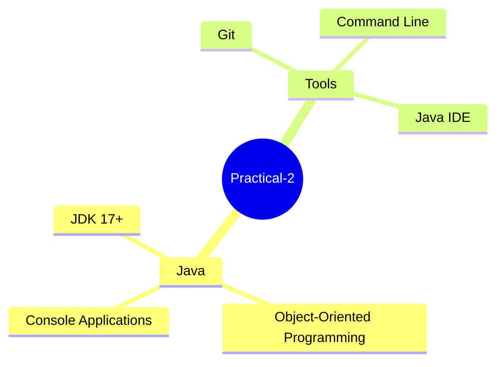

[](https://github.com/RomanSpichak/practical-2/actions/workflows/main.yml)

# 🚀 Practical-2

> A modern Java learning project focused on practical programming skills.

[](https://www.java.com/)
[](https://openjdk.org/)
[](https://github.com/RomanSpichak)

## 📖 Description

**Practical-2** demonstrates problem-solving using Java. The project is suitable for learning:

- 🧩 Basic Java syntax
- 🎯 Object-oriented programming
- 🖥️ Console application structure
- 🛠️ Building and running Java projects

## ✨ Technology Stack



## 🧭 Application Flow


## 🧰 Requirements

| Requirement | Description |
|---|---|
| ☕ JDK | Version 17 or later |
| 💻 IDE / Terminal | IntelliJ IDEA, Eclipse, VS Code, or terminal |
| 🐙 Git | Required to clone the repository |

## 🚀 Getting Started

### 1. Clone the repository

```bash
git clone https://github.com/RomanSpichak/practical-2.git
cd practical-2
```

### 2. Compile the source files

```bash
javac -d out $(find . -name "*.java")
```

### 3. Run the application

```bash
java -cp out Main
```

> ⚠️ The class name may differ depending on the project structure.

## 📁 Project Structure

```text
practical-2/
├── src/            # Java source code
├── README.md       # Project documentation
└── ...             # Additional project files
```

## 🔧 Development

After modifying the source code, rebuild the project:

```bash
javac -d out $(find src -name "*.java")
```

## 👤 Author

**RomanSpichak**

- 🐙 GitHub: [@RomanSpichak](https://github.com/RomanSpichak)
- 📦 Repository: [practical-2](https://github.com/RomanSpichak/practical-2)

## 📄 License

No license has been specified.